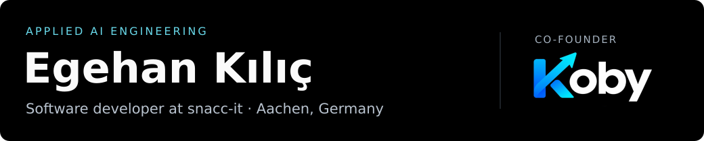

[Portfolio](https://www.egehankilic.com/) · [LinkedIn](https://www.linkedin.com/in/egehankilic/) · [Medium](https://medium.com/@egehankilic) · [CV](https://drive.google.com/file/d/1vOuynx1Rl-oiiMhM2neaFRo3UitEtUwb/view?usp=sharing) · [Email](mailto:egehanantalya@gmail.com)

I build ServiceNow applications at **snacc-it** and study computer science at **FH Aachen**. Two questions run through my work on AI systems. Which source supports this answer? And can the person using the software check it for themselves?

[Current work](#current-work) · [Projects](#selected-projects) · [Tools](#tools-i-use) · [Background](#background) · [Credentials](#credentials)

## Current work

- **Digital Product Passports.** At snacc-it I contribute to ETHICA, a research project on product data and compliance. My research interest is how to turn regulatory text into traceable rules for a product passport.
- **ServiceNow development.** I work on employee services, including travel reimbursement and sickness reporting. Much of the engineering happens at the edges of a form, where dates, attachments and approval rules need to agree.

## Selected projects

| Project | Inside the repository |
| --- | --- |
| [DeepScholar](https://github.com/egehank1/deepscholar) | A research assistant for academic PDFs. PostgreSQL and pgvector retrieve relevant passages, and a FastAPI backend returns answers with citations that readers can check. |
| [RFM Customer Segmentation](https://github.com/egehank1/rfm-customer-segmentation) | A Python analysis that groups customers by how recently they bought, how often they return and how much they spend. The notebooks use K-means to explore purchasing patterns. |
| [JPL Mars Rover](https://github.com/egehank1/jpl-mars-rover) | An interface for exploring rover imagery and mission data through NASA’s public APIs. |
| [Bank Application](https://github.com/egehank1/Bank_Application) | A JavaFX desktop application for accounts and transactions, with a Java domain model and JSON persistence. |

[Browse all repositories](https://github.com/egehank1?tab=repositories) · [Read about the design of DeepScholar](https://medium.com/@egehankilic/the-hardest-part-of-ai-research-tools-isnt-generation-it-s-trust-14cf5f11e37e)

## Tools I use

| Area | Tools |
| --- | --- |
| Retrieval and AI applications | Python, FastAPI, PostgreSQL, pgvector, OpenAI API |
| Data analysis | pandas, NumPy, scikit-learn, Jupyter |
| Interfaces and enterprise applications | TypeScript, React, Next.js, JavaScript, ServiceNow |
| Systems and desktop applications | C++, Java, JavaFX, Git, Linux |

## Background

I started studying computer science at **Özyeğin University** before transferring to **FH Aachen**, where I focus on autonomous systems and visual computing. I tutored students in C++ over two semesters and received an e-fellows.net scholarship, renewed in 2026.

Before my current role, I developed trading strategies with **Aachen Investment Club**. I also co-founded **Upstreak Media** and ran **Hardstyle Wear**, working on the storefront, campaigns and customer acquisition.

## Credentials

| Issuer | Credential | Year |
| --- | --- | --- |
| Haufe Akademie | EU AI Act · AI and data protection · AI and information security · Handling AI tools | 2026 |
| Apple | Apple Certified Swift Developer | 2025 |
| Cisco Networking Academy | Linux Essentials | 2025 |
| Michigan State University | Cameras, Exposure, and Photography | 2024 |
| telc | German C1 | 2023 |
| Özyeğin University | TRACE English C1 | 2021 |

[Credentials on LinkedIn](https://www.linkedin.com/in/egehankilic/details/certifications/) · [Experience and project case studies](https://www.egehankilic.com/)
