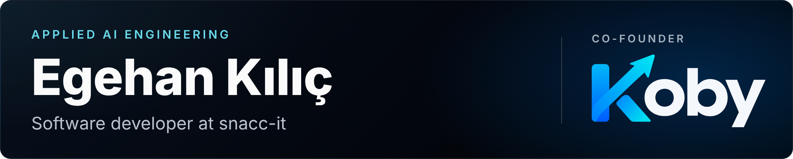

I'm a co-founder of **Koby**, where we're building an AI product that combines the data and field observations of small and medium-sized businesses to decide which improvements come first. I also work as a software developer at **snacc-it** and study computer science at **FH Aachen**.

**Start here:** [DeepScholar](https://github.com/egehank1/deepscholar), a research assistant that answers with checkable citations ([screenshots](https://github.com/egehank1/deepscholar/tree/main/docs/screenshots)), and the [RFM customer segmentation report](https://github.com/egehank1/rfm-customer-segmentation/blob/main/report.pdf).

**[Portfolio](https://www.egehankilic.com/) · [LinkedIn](https://www.linkedin.com/in/egehankilic/) · [Medium](https://medium.com/@egehankilic)**

Email: `egehanantalya@gmail.com` · [Open in Gmail](https://mail.google.com/mail/?view=cm&fs=1&to=egehanantalya%40gmail.com)

[Current work](#current-work) · [Projects](#selected-engineering-work) · [Technical focus](#technical-focus) · [Activity](#github-activity) · [Languages](#languages) · [Credentials](#credentials)

## Current work

### <picture><source media="(prefers-color-scheme: dark)" srcset="assets/koby-wordmark-on-dark.svg"></picture> · Co-founder

Koby turns business data and observations from the field into a recommended next step, with the reasoning behind it. I build the AI application. With coding agents I work in small, checkable steps: I reduce a problem to a test, review every diff, and try the change against missing data and restricted access before it ships.

### <picture><source media="(prefers-color-scheme: dark)" srcset="assets/snacc-it-dark.svg"></picture> · Software Developer

At snacc-it, my employer, I develop applications on the ServiceNow platform, including employee workflows for sickness reporting and travel reimbursement. I also work on ETHICA, a project on Digital Product Passports, where I look at how to link product-data requirements to the regulations behind them.

### ◇ AI research · FH Aachen

I read research on retrieval, LLM evaluation and structured outputs, then run small experiments to see where a method helps and where it breaks down.

## Selected engineering work

| Project | Inside the repository |
| --- | --- |
| [DeepScholar](https://github.com/egehank1/deepscholar) | A research assistant for academic PDFs. PostgreSQL and pgvector retrieve relevant passages, and a FastAPI backend returns answers with citations that readers can check. See the [screenshots](https://github.com/egehank1/deepscholar/tree/main/docs/screenshots) and the [design write-up](https://medium.com/@egehankilic/the-hardest-part-of-ai-research-tools-isnt-generation-it-s-trust-14cf5f11e37e). |
| [RFM Customer Segmentation](https://github.com/egehank1/rfm-customer-segmentation) | A team project in Python that groups retail customers by how recently they bought, how often they return and how much they spend. Read the [report](https://github.com/egehank1/rfm-customer-segmentation/blob/main/report.pdf) (German) or open the [notebook](https://github.com/egehank1/rfm-customer-segmentation/blob/main/notebooks/analysis.ipynb). |
| [JPL Mars Rover](https://github.com/egehank1/jpl-mars-rover) | An interface for exploring rover imagery and mission data through NASA’s public APIs. |
| [Bank Application](https://github.com/egehank1/Bank_Application) | A JavaFX desktop application for accounts and transactions, with a Java domain model and JSON persistence. |

[Browse all repositories](https://github.com/egehank1?tab=repositories)

## Technical focus

- **Languages:** Python, TypeScript, JavaScript, C++, Java and C.
- **Retrieval and AI applications:** FastAPI, PostgreSQL with pgvector, Supabase and the OpenAI API.
- **Data analysis and machine learning:** pandas, NumPy, scikit-learn, PyTorch and Jupyter.
- **Web and enterprise applications:** React, Next.js, Vercel and ServiceNow.
- **Desktop and tooling:** JavaFX, Git and Linux.

<picture>
  <source media="(prefers-color-scheme: dark)" srcset="https://skillicons.dev/icons?i=py,ts,js,cpp,java,c,react,nextjs,fastapi,postgres,supabase,vercel,sklearn,pytorch,git,linux&perline=8&theme=dark">
  <source media="(prefers-color-scheme: light)" srcset="https://skillicons.dev/icons?i=py,ts,js,cpp,java,c,react,nextjs,fastapi,postgres,supabase,vercel,sklearn,pytorch,git,linux&perline=8&theme=light">
  
</picture>

## GitHub activity

<a href="https://github.com/egehank1?tab=overview">
<picture>
  <source media="(prefers-color-scheme: dark)" srcset="https://github-profile-summary-cards.vercel.app/api/cards/profile-details?username=egehank1&theme=github_dark">
  <source media="(prefers-color-scheme: light)" srcset="https://github-profile-summary-cards.vercel.app/api/cards/profile-details?username=egehank1&theme=default">
  
</picture>
</a>

## Languages

<a href="https://github.com/egehank1?tab=repositories">
<picture>
  <source media="(prefers-color-scheme: dark)" srcset="https://github-profile-summary-cards.vercel.app/api/cards/repos-per-language?username=egehank1&theme=github_dark">
  <source media="(prefers-color-scheme: light)" srcset="https://github-profile-summary-cards.vercel.app/api/cards/repos-per-language?username=egehank1&theme=default">
  
</picture>
</a>

I work in Turkish, German and English. My German and English C1 credentials are listed below.

## Background

I started studying computer science at **Özyeğin University** before transferring to **FH Aachen**, where I focus on autonomous systems and visual computing. I tutored students in C++ over two semesters and received an e-fellows.net scholarship, renewed in 2026.

Before my current role, I developed trading strategies with **Aachen Investment Club**. I also co-founded **Upstreak Media** and ran **Hardstyle Wear**, working on the storefront, campaigns and customer acquisition.

## Credentials

| Issuer | Credential | Year |
| --- | --- | --- |
| Haufe Akademie | EU AI Act · AI and data protection · AI and information security · Handling AI tools | 2026 |
| Apple | Apple Certified Swift Developer | 2025 |
| Cisco Networking Academy | Linux Essentials | 2025 |
| Michigan State University | Cameras, Exposure, and Photography | 2024 |
| telc | German C1 | 2023 |
| Özyeğin University | TRACE English C1 | 2021 |

[Credentials on LinkedIn](https://www.linkedin.com/in/egehankilic/details/certifications/) · [Experience and project case studies](https://www.egehankilic.com/)
