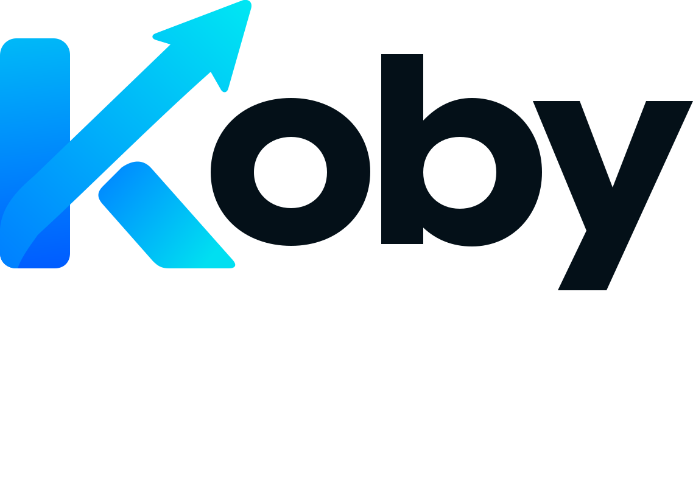

I'm a co-founder of **Koby**, where we build an AI product that combines the data and field observations of small and medium-sized businesses to decide which improvements come first. I also build AI systems on the ETHICA project as a software developer at **snacc-it**, and I study computer science at **FH Aachen**.

**Start here:** [DeepScholar](https://github.com/egehank1/deepscholar), a research assistant that answers with checkable citations ([screenshots](https://github.com/egehank1/deepscholar/tree/main/docs/screenshots)), and the [RFM customer segmentation report](https://github.com/egehank1/rfm-customer-segmentation/blob/main/report.pdf).

**[Portfolio](https://www.egehankilic.com/) · [LinkedIn](https://www.linkedin.com/in/egehankilic/) · [Medium](https://medium.com/@egehankilic)**

Email: `egehanantalya@gmail.com` · [Open in Gmail](https://mail.google.com/mail/?view=cm&fs=1&to=egehanantalya%40gmail.com)

[Current work](#current-work) · [Projects](#selected-engineering-work) · [Technical focus](#technical-focus) · [Activity](#github-activity) · [Languages](#languages) · [Credentials](#credentials)

## Current work

### <picture><source media="(prefers-color-scheme: dark)" srcset="assets/koby-wordmark-on-dark.svg"></picture> · Co-founder

Koby combines business data with observations from the field to recommend what a small business should improve first, and explains why. I build the AI side of the product: OpenAI API integrations, model selection and fine-tuning. With coding agents I work in small, checkable steps: I reduce a problem to a test, review every diff, and try the change against missing data and restricted access before it ships.

### <picture><source media="(prefers-color-scheme: dark)" srcset="assets/snacc-it-dark.svg"></picture> · Software Developer

- **ETHICA (AI):** I work on the AI side of Digital Product Passports. RAG systems and a vector database link product-data requirements to the regulatory passages behind them.
- **ServiceNow:** I turn internal processes such as employee workflows, sickness reporting and travel reimbursement into simple, well-designed applications for everyone in the company.

### ◇ Independent AI research

On my own time I follow papers, Medium write-ups and new tooling on RAG systems, machine learning models, agents and automation. I turn what I read into small experiments to see where a method helps and where it breaks down. My [AI engineering bootcamp repository](https://github.com/egehank1/ai-engineering-bootcamp) collects the hands-on work.

## Selected engineering work

| Project | Inside the repository |
| --- | --- |
| [DeepScholar](https://github.com/egehank1/deepscholar) | A research assistant for academic PDFs. PostgreSQL and pgvector retrieve relevant passages, and a FastAPI backend returns answers with citations that readers can check. See the [screenshots](https://github.com/egehank1/deepscholar/tree/main/docs/screenshots) and the [design write-up](https://medium.com/@egehankilic/the-hardest-part-of-ai-research-tools-isnt-generation-it-s-trust-14cf5f11e37e). |
| [AI Engineering Bootcamp](https://github.com/egehank1/ai-engineering-bootcamp) | Course notebooks and scripts on NLP pipelines, Transformers and Hugging Face, LangChain and OpenAI API integrations. |
| [RFM Customer Segmentation](https://github.com/egehank1/rfm-customer-segmentation) | A team project in Python that groups retail customers by how recently they bought, how often they return and how much they spend. Read the [report](https://github.com/egehank1/rfm-customer-segmentation/blob/main/report.pdf) (German) or open the [notebook](https://github.com/egehank1/rfm-customer-segmentation/blob/main/notebooks/analysis.ipynb). |
| [JPL Mars Rover](https://github.com/egehank1/jpl-mars-rover) | An interface for exploring rover imagery and mission data through NASA’s public APIs. |
| [Bank Application](https://github.com/egehank1/Bank_Application) | A JavaFX desktop application for accounts and transactions, with a Java domain model and JSON persistence. |

[Browse all repositories](https://github.com/egehank1?tab=repositories)

## Technical focus

- **AI and retrieval:** OpenAI API, RAG pipelines, vector databases (pgvector), model fine-tuning and evaluation, plus Hugging Face Transformers and LangChain from my bootcamp projects.
- **Languages:** Python, TypeScript, JavaScript, C++, Java and C.
- **Backend and data:** FastAPI, PostgreSQL, Supabase, Prisma, pandas, NumPy, scikit-learn and PyTorch.
- **Web and enterprise applications:** React, Next.js, Node.js, Vercel and ServiceNow.
- **Delivery and tooling:** Git, GitHub Actions, Linux and JavaFX.

<picture>
  <source media="(prefers-color-scheme: dark)" srcset="https://skillicons.dev/icons?i=py%2Cts%2Cjs%2Ccpp%2Cjava%2Cc%2Creact%2Cnextjs%2Cnodejs%2Cfastapi%2Cpostgres%2Csupabase%2Cprisma%2Cvercel%2Csklearn%2Cpytorch%2Cgithubactions%2Cgit%2Clinux&perline=10&theme=dark">
  <source media="(prefers-color-scheme: light)" srcset="https://skillicons.dev/icons?i=py%2Cts%2Cjs%2Ccpp%2Cjava%2Cc%2Creact%2Cnextjs%2Cnodejs%2Cfastapi%2Cpostgres%2Csupabase%2Cprisma%2Cvercel%2Csklearn%2Cpytorch%2Cgithubactions%2Cgit%2Clinux&perline=10&theme=light">
  
</picture>

## GitHub activity

  <a href="https://github.com/egehank1?tab=overview">
  <picture>
    <source media="(prefers-color-scheme: dark)" srcset="https://streak-stats.demolab.com/?user=egehank1&theme=default&background=0d1117&border=30363d&stroke=30363d&ring=58a6ff&fire=58a6ff&currStreakNum=e6edf3&sideNums=e6edf3&currStreakLabel=58a6ff&sideLabels=e6edf3&dates=9da7b3&timezone=Europe%2FBerlin&disable_animations=true&card_width=420">
    <source media="(prefers-color-scheme: light)" srcset="https://streak-stats.demolab.com/?user=egehank1&theme=default&background=ffffff&border=d0d7de&stroke=d0d7de&ring=1f6feb&fire=1f6feb&currStreakNum=24292f&sideNums=24292f&currStreakLabel=1f6feb&sideLabels=24292f&dates=57606a&timezone=Europe%2FBerlin&disable_animations=true&card_width=420">
    
  </picture>
  </a>
  <a href="https://github.com/egehank1?tab=repositories">
  <picture>
    <source media="(prefers-color-scheme: dark)" srcset="https://github-profile-summary-cards.vercel.app/api/cards/repos-per-language?username=egehank1&theme=github_dark">
    <source media="(prefers-color-scheme: light)" srcset="https://github-profile-summary-cards.vercel.app/api/cards/repos-per-language?username=egehank1&theme=default">
    
  </picture>
  </a>

## Languages

I work in German, English and Turkish. My German (telc) and English (TRACE) C1 certificates are listed under [Credentials](#credentials).

## Background

I started studying computer science at **Özyeğin University** before transferring to **FH Aachen**, where I focus on autonomous systems and visual computing. I tutored students in C++ over two semesters and received an e-fellows.net scholarship, renewed in 2026.

Before my current role, I developed trading strategies with **Aachen Investment Club**. I also co-founded **Upstreak Media** and ran **Hardstyle Wear**, working on the storefront, campaigns and customer acquisition.

## Credentials

| Issuer | Credential | Year |
| --- | --- | --- |
| Haufe Akademie | EU AI Act · AI and data protection · AI and information security · Handling AI tools | 2026 |
| Apple | Apple Certified Swift Developer | 2025 |
| Cisco Networking Academy | Linux Essentials | 2025 |
| Michigan State University | Cameras, Exposure, and Photography | 2024 |
| telc | German C1 | 2023 |
| Özyeğin University | TRACE English C1 | 2021 |

[Credentials on LinkedIn](https://www.linkedin.com/in/egehankilic/details/certifications/) · [Experience and project case studies](https://www.egehankilic.com/)
